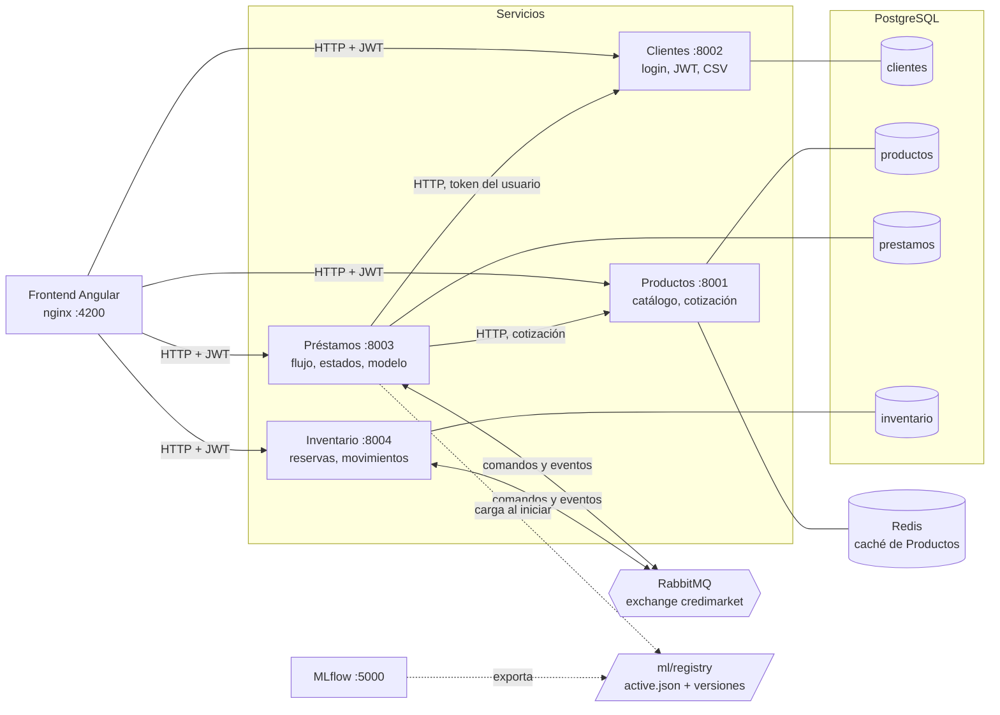
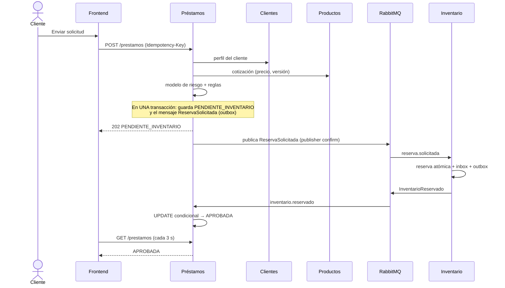
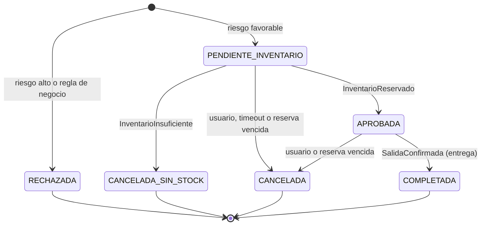
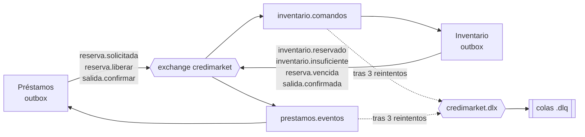

# Arquitectura de CrediMarket

Los diagramas están en Mermaid: GitHub los dibuja directamente al abrir este archivo.

## 1. Vista general

Reglas que sostienen el diseño: cada servicio solo lee **su** base de datos; entre servicios solo hay API HTTP o mensajes; el modelo se carga al iniciar desde la versión que apunta `active.json`, verificando el SHA-256 del artefacto.

## 2. Secuencia de una solicitud (camino feliz)

Si no hay stock, Inventario publica `InventarioInsuficiente` y el préstamo pasa a `CANCELADA_SIN_STOCK`. Si Inventario no responde en 60 s, un temporizador lo cancela por `TIMEOUT_INVENTARIO` y publica `LiberarReserva` en la misma transacción.

## 3. Máquina de estados del préstamo

Cada cambio es un `UPDATE ... WHERE estado = <esperado>`: si dos eventos compiten, solo uno cambia el estado. Un evento tardío **nunca reactiva** un préstamo ya final; Préstamos publica `LiberarReserva` para deshacer la reserva.

## 4. Mensajería y garantías

- **Outbox transaccional:** el mensaje se guarda en la misma transacción que el cambio de estado; un publicador lo envía con *publisher confirms*. Entrega **al menos una vez**.
- **Inbox:** `mensajes_procesados(message_id)` descarta duplicados. El *ack* se envía **después** del commit.
- **Reintentos:** hasta 3 (cabecera `x-reintentos`); después `nack` sin reencolar y el mensaje va a la cola de mensajes muertos.
- Detalle completo en [mensajeria.md](mensajeria.md); decisiones y su razón en [decisiones.md](decisiones.md).
