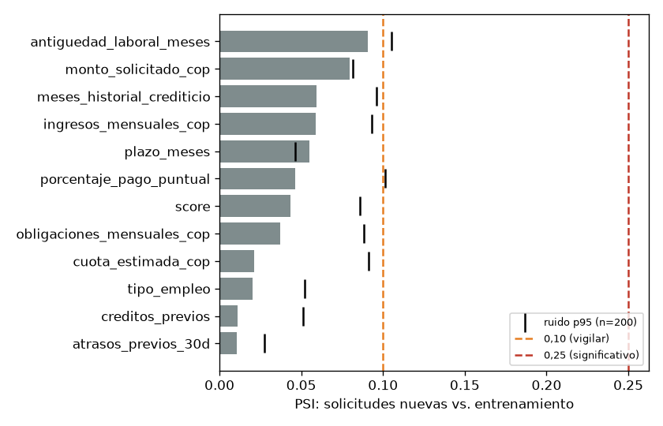

# Etapa F — Monitoreo y drift simulado (PSI)

Generado por `ml/scripts/etapa_f_drift.py` el 2026-11-16T23:31:43+00:00. No editar a mano.

## Qué se compara

- **Referencia:** partición de entrenamiento (7,200 filas), la distribución que vio el modelo.
- **Actual:** `ml/data/solicitudes_nuevas.csv` (200 solicitudes, SHA-256 `1430d7b34e924d5e4170c4fb9d9a412c1000af17c062af513ef15e44a1a7f1f7`).
- **Modelo para el score:** versión activa `v1` (umbral 0.25).

PSI = Σ (actual − referencia) · ln(actual / referencia) sobre grupos fijados con la referencia (deciles para numéricas; un grupo por valor para tipo_empleo, plazo_meses; los faltantes, grupo propio). Umbrales usuales: < 0,10 estable; 0,10–0,25 moderado; > 0,25 significativo.

**Ruido de muestreo.** Con 200 solicitudes el PSI nunca es 0 aunque no haya drift. Se tomaron 1000 muestras de 200 filas de *validación* (sin drift) y se calculó su PSI contra la misma referencia: la columna *ruido p95* es el PSI que el azar alcanza el 5 % de las veces. Una variable queda en **alerta** solo si supera 0,10 **y** su ruido p95.

## Resultado

| Variable | PSI | Nivel | Ruido p95 | Alerta | Media ref. | Media nueva | Falt. ref. | Falt. nueva |
|---|---|---|---|---|---|---|---|---|
| `antiguedad_laboral_meses` | 0.0908 | estable | 0.1051 | no | 37.4 | 39.39 | 0.8% | 0.5% |
| `monto_solicitado_cop` | 0.0794 | estable | 0.0813 | no | 3.991e+06 | 3.654e+06 | 0.0% | 0.0% |
| `meses_historial_crediticio` | 0.0591 | estable | 0.0962 | no | 56.49 | 56.38 | 0.8% | 0.5% |
| `ingresos_mensuales_cop` | 0.0587 | estable | 0.0930 | no | 4.867e+06 | 4.736e+06 | 0.0% | 0.0% |
| `plazo_meses` | 0.0551 | estable | 0.0465 | no | 19.82 | 20.43 | 0.0% | 0.0% |
| `porcentaje_pago_puntual` | 0.0465 | estable | 0.1015 | no | 83.25 | 84.45 | 20.4% | 21.5% |
| `score` | 0.0436 | estable | 0.0860 | no | 0.3056 | 0.3227 | 0.0% | 0.0% |
| `obligaciones_mensuales_cop` | 0.0373 | estable | 0.0883 | no | 1.385e+06 | 1.357e+06 | 0.0% | 0.0% |
| `cuota_estimada_cop` | 0.0212 | estable | 0.0913 | no | 3.087e+05 | 2.858e+05 | 0.0% | 0.0% |
| `tipo_empleo` | 0.0203 | estable | 0.0520 | no | — | — | 0.8% | 1.0% |
| `creditos_previos` | 0.0109 | estable | 0.0513 | no | 2.37 | 2.355 | 0.0% | 0.0% |
| `atrasos_previos_30d` | 0.0105 | estable | 0.0276 | no | 0.7738 | 0.985 | 0.0% | 0.0% |

`score` es la probabilidad de incumplimiento de `v1`. Con el umbral activo, la tasa de rechazo sería 58.5% en las solicitudes nuevas frente a 56.9% en entrenamiento.

## Lectura

Ninguna variable supera a la vez el umbral de 0,10 y el ruido de muestreo: **no hay evidencia de drift** con estas 200 solicitudes. Los valores de PSI observados son compatibles con el azar.

## Escenario de drift inducido (sintético)

Para comprobar que el monitor **sí detecta** un cambio cuando existe, se alteraron a propósito las mismas 200 solicitudes nuevas: ingresos −20 % (como en una recesión) y 30 % de los dependientes pasan a temporales. **Son datos sintéticos, solo para esta prueba de sensibilidad**; no se usan para entrenar ni se presentan como solicitudes reales.

| Variable | PSI real | PSI inducido | Ruido p95 | Alerta inducido |
|---|---|---|---|---|
| `score` | 0.0436 | 0.2783 | 0.0860 | **sí** |
| `tipo_empleo` | 0.0203 | 0.2007 | 0.0520 | **sí** |
| `ingresos_mensuales_cop` | 0.0587 | 0.1661 | 0.0930 | **sí** |
| `antiguedad_laboral_meses` | 0.0908 | 0.0908 | 0.1051 | no |
| `monto_solicitado_cop` | 0.0794 | 0.0794 | 0.0813 | no |
| `meses_historial_crediticio` | 0.0591 | 0.0591 | 0.0962 | no |
| `plazo_meses` | 0.0551 | 0.0551 | 0.0465 | no |
| `porcentaje_pago_puntual` | 0.0465 | 0.0465 | 0.1015 | no |
| `obligaciones_mensuales_cop` | 0.0373 | 0.0373 | 0.0883 | no |
| `cuota_estimada_cop` | 0.0212 | 0.0212 | 0.0913 | no |
| `creditos_previos` | 0.0109 | 0.0109 | 0.0513 | no |
| `atrasos_previos_30d` | 0.0105 | 0.0105 | 0.0276 | no |

Variables en alerta: `score`, `tipo_empleo`, `ingresos_mensuales_cop`. Con el umbral activo, el rechazo pasaría de 58.5% a 74.0%. Las variables que no se tocaron siguen con el mismo PSI: el monitor señala exactamente dónde está el cambio.

## Qué se haría en operación

- Calcular este reporte de forma periódica (p. ej. semanal) sobre las solicitudes recibidas por Préstamos.
- PSI > 0,10 por encima del ruido en una variable: revisar la fuente (cambio de producto, de canal, error de captura) antes de tocar el modelo.
- PSI > 0,25 en el `score` o en varias variables importantes: reentrenar con datos recientes, exportar una versión nueva, compararla contra la activa en validación y promoverla con `promover.py` (rollback disponible).
- El drift de las entradas no prueba que el modelo se degradó: para eso se necesita la etiqueta real (incumplimiento a 90 días), que llega con 3 meses de retraso.
