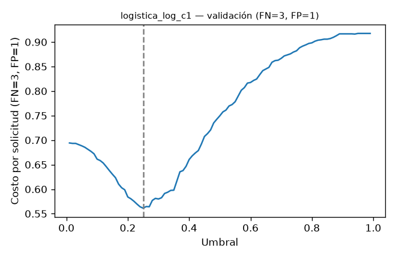

# Informe de selección del modelo de riesgo — CrediMarket

Autor: Juan David Sepúlveda Londoño. Fecha: 16 de noviembre de 2026.
Modelo activo: **v1** (`ml/registry/active.json`). Experimento MLflow: `credimarket-riesgo-incumplimiento`.

## 1. Resumen

| | |
|---|---|
| **Problema** | Estimar la probabilidad de que un solicitante incumpla a 90 días (`incumplimiento_90d = 1`) |
| **Modelo elegido (v1)** | Regresión logística (C = 1) con `log1p` en las 4 variables en pesos. Run `85efdae3d30f4c83bdfea56e49895c96` |
| **Métrica de selección** | Average precision (AP) en validación, fijada antes de entrenar |
| **Umbral** | 0,25, elegido en validación con costos FN = 3 y FP = 1, y congelado antes de la prueba |
| **Prueba (una sola vez)** | AP 0,511 · ROC-AUC 0,686 · Brier 0,191 · recall 0,735 · precisión 0,397 |
| **Efecto de negocio (prueba)** | Rechaza el 56,6 %. Entre los aprobados, el incumplimiento baja de 30,6 % a 18,6 % |
| **Retador (v2)** | Gradient boosting. Empató en AP pero perdió por Brier. Se promovió y se revirtió en la prueba 11 |
| **Drift** | Las 200 solicitudes nuevas no muestran drift. Con un drift sintético, el monitor detecta las variables alteradas |

## 2. Datos (etapa A)

Detalle completo en [`reporte_datos.md`](reporte_datos.md).

- `prestamos_entrenamiento.csv`: 12 000 filas, SHA-256 `c6cdc437c3aecc9116bc8b978df421d5a7600634c1ad7d6f82e58222a2446ecd`. Sin duplicados, sin valores fuera de rango y con la cuota consistente con la fórmula del contrato (error relativo máximo de 2,5·10⁻⁷).
- 30,6 % de incumplimiento. Por eso no se usa accuracy: un modelo que aprueba a todos tendría 69,4 %.
- **Partición 60/20/20** estratificada con semilla 42: 7 200 / 2 400 / 2 400 filas, cada una con 30,6 % de positivos. Los ids de cada partición están en `data/particiones.csv`. Cada cliente aparece una sola vez, así que no hay fuga de información entre clientes.
- **Preprocesamiento dentro del pipeline**, ajustado solo con entrenamiento:
  - Variables numéricas: mediana más un indicador de faltante. `porcentaje_pago_puntual` falta exactamente cuando `creditos_previos = 0`, es decir, es un faltante estructural.
  - Variables en pesos: `log1p` (solo en los candidatos `_log`).
  - `tipo_empleo`: los faltantes, sean `None` o `NaN`, pasan a la categoría `"desconocido"` y luego se aplica one-hot.
  - Escalado: `StandardScaler`.
- **Excluidas:** `solicitud_id` y `cliente_id` (identificadores), `tasa_mensual_simulada` (constante, igual a 0,018) e `incumplimiento_90d` (la etiqueta).

## 3. Protocolo: qué se decidió y cuándo

Cada paso deja un archivo versionado o una marca en MLflow, de modo que el orden se puede verificar.

| Hora (UTC) | Paso | Evidencia |
|---|---|---|
| antes de 22:54 | Criterio de selección, desempate y costos escritos | [`criterio_seleccion.md`](criterio_seleccion.md); su SHA-256 queda en cada run (`criterio_sha256`) |
| 22:54 | 9 ejecuciones entrenadas con *entrenamiento* y medidas con *validación* | Tanda `20261116T175459`, [`seleccion/comparacion_validacion.csv`](seleccion/comparacion_validacion.csv) |
| ~22:58 | Revisión de los costos de 5:1 a 3:1, mirando solo resultados de validación | [`criterio_seleccion.md` §5](criterio_seleccion.md) |
| 23:00:31 | Criterio aplicado en código y umbral congelado en 0,25 | [`seleccion/umbral_congelado.json`](seleccion/umbral_congelado.json) |
| 23:00:48 | **Única** evaluación de la partición de prueba | [`seleccion/evaluacion_prueba.json`](seleccion/evaluacion_prueba.json). El script se niega a correr otra vez |
| 23:01 | v1 exportada y promovida | `registry/v1/manifest.json`, `registry/active.json` |
| 23:18 | Retador v2 preparado sin usar la prueba | [`seleccion/retador_gradient_boosting.json`](seleccion/retador_gradient_boosting.json) |

## 4. Candidatos (etapa B)

Hay 4 algoritmos más un baseline trivial, en 8 ejecuciones candidatas. Los hiperparámetros se eligieron a mano, con regularización conservadora y sin búsqueda en malla. Con 2 400 filas de validación, una búsqueda amplia terminaría sobreajustándose a la validación.

| Candidato | Hiperparámetros principales | AP val. | ROC-AUC val. | Brier val. | AP entren. |
|---|---|---|---|---|---|
| baseline_prior | `DummyClassifier(strategy="prior")` | 0,3058 | 0,5000 | 0,2123 | 0,3056 |
| logistica_c1 | C = 1 | 0,5045 | 0,6931 | 0,1907 | 0,5297 |
| **logistica_log_c1** | C = 1, `log1p` en pesos | **0,5098** | 0,6930 | **0,1901** | 0,5419 |
| logistica_log_balanceada | C = 1, `log1p`, `class_weight="balanced"` | 0,5085 | 0,6929 | 0,2205 | 0,5413 |
| arbol_p5 | profundidad 5, hoja ≥ 50 | 0,4401 | 0,6393 | 0,2013 | 0,5112 |
| arbol_p8 | profundidad 8, hoja ≥ 100 | 0,4443 | 0,6468 | 0,2021 | 0,5254 |
| random_forest_300 | 300 árboles, hoja ≥ 20 | 0,4974 | 0,6830 | 0,1927 | 0,7150 |
| random_forest_500_p12 | 500 árboles, profundidad 12, hoja ≥ 10 | 0,4943 | 0,6815 | 0,1927 | 0,8041 |
| gradient_boosting | HistGB, lr 0,05, 300 iteraciones, 15 hojas | 0,5091 | 0,6819 | 0,1926 | 0,7627 |

Lo que muestra la tabla:
- **Todos los candidatos superan claramente al baseline** (AP de 0,44 a 0,51 contra 0,31). Aun así, la señal de los datos es moderada: el ROC-AUC máximo ronda 0,69, igual que el del modelo provisional `v0-basico`.
- **El `log1p` ayuda a la logística** (AP 0,5045 → 0,5098). En escala logarítmica, log(obligaciones) − log(ingresos) = log(carga financiera), así que el modelo lineal puede aprender esas proporciones sin que Préstamos tenga que calcular columnas nuevas. En el análisis exploratorio, la razón obligaciones/ingresos predice mejor que cada monto por separado (ρ de Spearman 0,18 contra 0,05).
- **Los modelos de conjunto sobreajustan:** su AP en entrenamiento (0,72 a 0,80) es muy superior al de validación (0,49 a 0,51). La relación entre las variables y el riesgo es casi monótona, y la flexibilidad adicional se gasta en memorizar ruido.
- `class_weight="balanced"` no mejora el ordenamiento (AP), pero desplaza las probabilidades hacia arriba y empeora la calibración (Brier 0,2205). Como el umbral se elige aparte con costos, no hace falta reponderar las clases.

Cada run de MLflow registra:
- algoritmo, hiperparámetros, semilla, estrategia de partición y tamaños;
- hashes del CSV y de las particiones, lista de características y preprocesamiento;
- commit, dependencias, duración y métricas de entrenamiento y validación;
- artefactos: `pipeline.joblib`, matrices de confusión, reporte de clasificación, curva de costos y copia del código.

## 5. Selección

La regla está escrita en `criterio_seleccion.md` y se aplica en código (`scripts/etapa_d_seleccionar.py`):

1. El mejor AP es 0,5098. A menos de 0,005 quedan `logistica_log_c1` (0,5098), `gradient_boosting` (0,5091) y `logistica_log_balanceada` (0,5085).
2. Se desempata por Brier, con un margen de 0,002. El mejor es 0,1901 y solo **`logistica_log_c1`** queda dentro del margen: gradient boosting tiene 0,1926 y la balanceada 0,2205.

El ganador es también el modelo más simple de los empatados: se puede explicar con sus coeficientes y su serialización es pequeña.

## 6. Umbral y costos

Costo esperado por solicitud = (3·FN + 1·FP) / n. Aprobar a quien incumplirá cuesta 3; rechazar a quien habría pagado cuesta 1. El umbral se busca en una malla de 0,01 a 0,99 sobre validación.

- Umbral elegido: **0,25**. Coincide con el teórico 1/(1+3) para probabilidades calibradas, lo que confirma que las probabilidades de la logística están bien calibradas.
- **Revisión de 5:1 a 3:1** (documentada en el §5 del criterio, antes de usar la prueba). Con 5:1, el umbral óptimo (≈ 0,17) queda por debajo de la tasa base del 30,6 %: se rechazaba el 79,8 % de las solicitudes y el costo bajaba solo 3,5 % frente a rechazar a todos. La elección del modelo no depende de los costos, porque se hace por AP; solo cambia el umbral.

Efecto de distintas razones de costos sobre v1 (en validación):

| Costos FN:FP | Umbral | Rechazo | Recall | Ahorro frente a la mejor regla trivial |
|---|---|---|---|---|
| 5:1 | 0,17 | 79,8 % | 0,903 | 3,5 % |
| 4:1 | 0,20 | 71,8 % | 0,860 | 9,7 % |
| **3:1** | **0,25** | **57,9 %** | **0,764** | **19,1 %** |
| 2:1 | 0,35 | 33,2 % | 0,533 | 25,6 % |



## 7. Evaluación en prueba (única)

| Métrica | Validación | Prueba |
|---|---|---|
| Average precision | 0,5098 | 0,5111 |
| ROC-AUC | 0,6930 | 0,6857 |
| Brier | 0,1901 | 0,1906 |
| Precisión (clase 1) | 0,4039 | 0,3966 |
| Recall (clase 1) | 0,7643 | 0,7353 |
| F1 (clase 1) | 0,5285 | 0,5153 |
| Tasa de rechazo | 57,9 % | 56,6 % |
| Costo por solicitud | 0,5613 | 0,5842 |

Matriz de confusión en prueba con umbral 0,25 (filas: real; columnas: predicción):

| | Aprobar (0) | Rechazar (1) |
|---|---|---|
| **Paga (0)** | 847 | 820 |
| **Incumple (1)** | 194 | 539 |

Las métricas de prueba quedan muy cerca de las de validación. Eso indica que ni la selección ni el umbral se sobreajustaron a la validación.

**Lectura de negocio.** En prueba se aprueba al 43,4 % de los solicitantes, y de ellos incumple el **18,6 %**, frente al 30,6 % si se aprobara a todos. El costo es rechazar a 820 buenos pagadores de cada 2 400 solicitudes: con una señal moderada (ROC-AUC de 0,69), atrapar al 74 % de los incumplidores exige rechazar también a muchos que habrían pagado. La exigencia la fija el umbral, que es una decisión de negocio, no el modelo. Si se cambian los costos, se cambia el umbral sin reentrenar.

## 8. Versiones exportadas (etapa D)

| | v1 (activa) | v2 (retador) |
|---|---|---|
| Algoritmo | Regresión logística + `log1p` | HistGradientBoosting |
| Run | `85efdae3d30f4c83bdfea56e49895c96` | `fa7a2a4cee3e45ccb2febd674340a826` |
| Umbral (3:1, en validación) | 0,25 | 0,20 |
| AP / Brier en validación | 0,5098 / 0,1901 | 0,5091 / 0,1926 |
| Rechazo / recall en validación | 57,9 % / 0,764 | 64,5 % / 0,797 |
| Costo por solicitud en validación | **0,5613** | 0,5871 |
| Métricas de prueba | Sí | No: la prueba se usó una sola vez, para v1 |
| `artefacto_sha256` | `4103c6f7…1ddfe4` | `8045e59b…bc8364` |

El umbral de v2 queda por debajo del teórico (0,20 contra 0,25) porque sus probabilidades están peor calibradas. Con los mismos costos, v2 rechaza más y cuesta más que v1, y por eso **no se mantiene en producción**.

Cada carpeta `registry/vN/` contiene:
- `pipeline.joblib`: el artefacto exacto del run de MLflow, copiado sin reentrenar, así que su hash coincide;
- `manifest.json` con todos los campos del contrato 4.3;
- `ejemplo_entrada.json` y `ejemplo_salida.json`.

`scripts/promover.py` es el único que modifica `active.json`. Antes de cambiarlo verifica lo mismo que Préstamos revisa al arrancar: hash, 11 columnas en orden, `clase_positiva = 1` y umbral dentro de (0, 1). Escribe el archivo de forma atómica y registra cada operación en `historial`.

## 9. Verificación con Préstamos

- **Prueba 10 (pipeline frente a API):** 23 de 23 casos con diferencia 0,0. Incluye 10 solicitudes completas y casos con cada tipo de faltante enviado como `null`, también en `tipo_empleo`, que era el caso donde v0 daba resultados distintos con `None` y con `NaN`. Evidencia: [`evidencia/prueba10.log`](evidencia/prueba10.log).
- **Prueba 11 (promoción y rollback):** v1 → v2 → v1, verificado en cada paso con `/modelo/info` y `/riesgo/predict`. Evidencia: [`evidencia/prueba11.log`](evidencia/prueba11.log) y el `historial` de `active.json`.

## 10. Monitoreo (etapa F)

Detalle completo en [`reporte_drift.md`](reporte_drift.md). Se calculó el PSI de cada variable y del score de v1 entre las 200 solicitudes nuevas y la partición de entrenamiento. Como referencia de ruido se usó el percentil 95 del PSI de 1 000 muestras de 200 filas de validación, donde no hay drift.

- **Datos reales:** ninguna variable supera 0,10 junto con su ruido, así que **no hay drift**. El rechazo con v1 sería 58,5 %, frente a 56,9 % en entrenamiento.
- **Escenario sintético** (ingresos −20 % y 30 % de los dependientes pasan a temporales): el monitor marca exactamente `ingresos_mensuales_cop` (0,166), `tipo_empleo` (0,201) y el score (0,278, significativo). El rechazo subiría a 74,0 %.

## 11. Limitaciones

- La señal de los datos es moderada (ROC-AUC de 0,69). Ningún algoritmo probado la supera de forma clara; para mejorar haría falta más información sobre el solicitante, no un modelo más complejo.
- Los costos son ficticios. Con costos reales el umbral cambiaría, aunque el modelo no.
- v2 no tiene métricas de prueba, por decisión de protocolo: la prueba se usa una sola vez.
- El monitor de drift mira las entradas, no el desempeño. Para medir el desempeño hace falta la etiqueta real, que llega 90 días después.
- Hay un caso que el preprocesador no cubre: `pd.NA`. Préstamos construye las entradas con `None` y `NaN`, que sí están cubiertos y probados.

## 12. Cómo reproducir

Desde la raíz del repo, con `ml/.venv` (Python 3.11 y `ml/requirements.txt`) y el compose arriba:

```bash
export MLFLOW_TRACKING_URI=http://localhost:5000
ml/.venv/bin/python ml/scripts/etapa_a_datos.py          # validación, EDA, particiones
ml/.venv/bin/python ml/scripts/etapa_b_entrenar.py       # 9 runs en MLflow
ml/.venv/bin/python ml/scripts/etapa_d_seleccionar.py    # criterio + umbral congelado
ml/.venv/bin/python ml/scripts/evaluar_prueba.py         # prueba, una sola vez
ml/.venv/bin/python ml/scripts/exportar.py v1
ml/.venv/bin/python ml/scripts/etapa_d_retador.py gradient_boosting
ml/.venv/bin/python ml/scripts/exportar.py v2 --decision ml/seleccion/retador_gradient_boosting.json
ml/.venv/bin/python ml/scripts/promover.py promover v1 --motivo "..." --por "..."
docker compose restart prestamos
ml/.venv/bin/python ml/scripts/prueba10.py
ml/.venv/bin/python ml/scripts/prueba11.py
ml/.venv/bin/python ml/scripts/etapa_f_drift.py
ml/.venv/bin/python -m pytest -q ml/tests
```

Notas:
- Volver a entrenar crea runs nuevos con otros `run_id`, pero las mismas métricas, porque la semilla es fija.
- `evaluar_prueba.py` y `exportar.py` se niegan a sobrescribir sus resultados.
